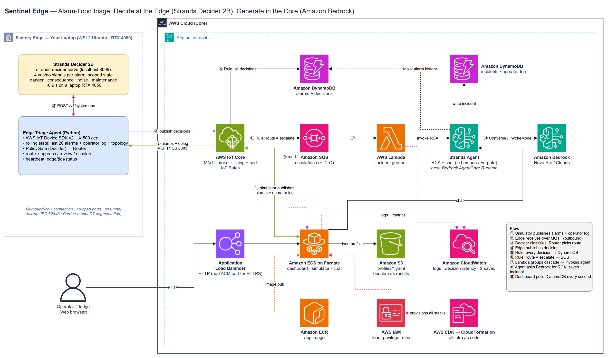

# Sentinel Edge: taming factory alarm floods with Strands Decider 2B

*Tags: #strands-decider-2b #policy*

## The problem: forty alarms, one that matters

A cooling-water pump trips in a solvent recovery unit. Within seconds the condenser runs hot, the column pressure climbs, the reflux drum level rises, a chattering level switch keeps firing, and somewhere in that scroll a relief valve starts to lift. The operator sees a wall of red. Alarm-management standards (ISA-18.2) call this an alarm flood, and it is a well-known factor in industrial incidents: the alarm that matters arrives with dozens that don't.

An LLM could read every alarm and sort them. But a plant raises thousands of alarms a day, the alarms live on an isolated OT network, and asking a frontier model to label a chattering level switch for the 400th time is slow and expensive. This is a high-frequency decision, the kind Strands Decider 2B was built for.

## What I built

**Sentinel Edge** is an alarm-flood triage agent. It splits the work in two:

- **Edge (a laptop standing in for a factory edge box):** Strands Decider 2B runs locally on an RTX 4050. An edge agent receives each alarm over MQTT from AWS IoT Core, asks Decider about it, routes it, and publishes the decision back. The connection is outbound only, with an X.509 certificate and no open ports, the way OT networks are segmented in practice.
- **Core (AWS):** IoT Rules write every decision to DynamoDB and send escalated alarms to SQS. A Lambda groups a cascade into one incident and asks a Strands agent on Amazon Bedrock for the root cause and next steps. A Fargate dashboard shows the stream, the incidents, and a chat with the agent.

All plant knowledge (equipment, how it connects, the alarm catalog, and labelled scenarios) lives in YAML profiles. I shipped three industries: a chemical process plant, a juice bottling line, and an automotive weld cell.

## The decision I handed to Decider 2B

*"How should the control room treat this new alarm?"*: escalate it to the LLM, show it to the operator for review, or suppress it. That's the **policy** pattern: classify the incoming request before the agent acts on it. Suppressed alarms never reach the model.

## What I learned (and the numbers)

**1. One multi-way question is the wrong shape.** My first version asked a single `choice`: safety-critical / actionable / duplicate / nuisance. Accuracy: **45%**. Those categories aren't exclusive. A relief valve lifting during a cascade is both dangerous and a consequence, and a single softmax makes them compete. Splitting the question into yes/no **signals** (`danger`, `consequence`, `noise`, `maintenance`) asked in one request, with Python deciding precedence (danger outranks everything), reached **90%** on the plant I was tuning on.

**2. Held-out data told the real story.** I wrote the other two industries before looking at any results and froze the thresholds. Accuracy dropped to **57-60%**. The errors had a pattern: once a safety alarm was active, Decider scored *every* later alarm as dangerous, and a maintenance note about one robot leaked onto its neighbour. The small model was answering the question the context suggested ("is the plant in danger?") instead of the one I asked ("is *this alarm* dangerous?").

**3. Scope the context per signal.** Each signal now sees only what it needs: danger and noise see the alarm alone, maintenance sees the alarm plus the operator log, and only consequence sees the whole cascade and topology. Held-out accuracy rose to **79-80%**, at the cost of three requests per alarm (~0.9 s on a laptop GPU). That's still well within what a control room needs, and it was the biggest single improvement.

**4. Against an LLM doing the same job** (49 labelled alarms, Amazon Nova Pro on Bedrock):

| | Decider-gated agent | LLM-only agent |
|---|---|---|
| category accuracy | 81.6% | 81.6% (87.8% on an earlier run) |
| real alarms hidden from the operator | 0 | 0 |
| decision latency p50 | 955 ms | 1,695 ms |
| LLM calls | 11 | 49 |
| LLM tokens | 4.1k | 50.1k |

Accuracy came out equal, but the mistakes differed. The LLM over-escalates: it calls downstream consequences "actionable", which is exactly the flood the operator is trying to escape. Decider's misses land in "review" because of an asymmetric router: uncertain danger is never suppressed, and if Decider is down, everything goes to a human. In this run the gated agent made 78% fewer LLM calls and used 92% fewer tokens, and the per-alarm decision costs nothing on hardware the plant already owns.

**5. Low confidence goes to a human, not the bin.** Decider returns probabilities, not verdicts, so the router has three outcomes, not two. An alarm is only suppressed when Decider is confident it's noise (≥ 0.60) or a duplicate (≥ 0.55). Any alarm whose danger signal sits in the uncertain band (0.35–0.50) is never suppressed, whatever else it looks like. Everything in between goes to **review**: the operator sees it, but no LLM is called. In the benchmark this caught the hardest case: a gas alarm at 25% LEL scored danger 0.45, just under the cut. It was mislabelled as a duplicate, yet still landed in front of the operator. If the Decider server is unreachable, the gate fails toward review too, so an outage can never silence the alarm board.

**6. Keep the policy in code.** Decider measures; Python decides. Thresholds sit in a reviewable file, are covered by unit tests, and can be overridden per plant in YAML. For anything near safety, that separation matters more than a few points of accuracy.

## The reusable pattern

The `decider_policy` package has no manufacturing knowledge in it:

- `PolicyGate(signals, classify, route, scopes=...)`: ask N yes/no signals (grouped by scope, one request per scope), then call your functions.
- `PolicyGateIntervention`: a Strands `InterventionHandler` whose `before_invocation` returns `Deny` for routes you block, so the agent never reaches the model.

Swap the signals and the two functions, and it triages support tickets, log lines, or pull requests the same way. The recipe and code are in the repo's `decider_policy/README.md`.

## Limits

49 labelled alarms is a small evaluation, and Decider 2B is explicitly experimental. This is a prototype of an idea, not a safety system: suppressing alarms in a real plant requires a formal alarm-management review. The next steps I'd take are more labelled data per industry, moving the agent onto Bedrock AgentCore Runtime, and installing the optimized kernels that the server warned it was missing, to bring the laptop latency down.

**Repo:** _(link)_ · **Demo video:** _(link)_
